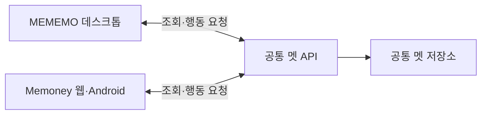

# MEMEMO·Memoney 공통 멧 시스템 설계

작성일: 2026-10-18

## 목적과 현재 범위

MEMEMO의 멧하우스에서 키우던 같은 멧을 Memoney에서도 확인하고 돌볼 수 있도록 한다. 두 앱을 동시에 켜두는 것은 허용하고, 보상·아이템·탐험 등의 행동이 충돌하거나 중복 처리되지 않도록 설계한다.

이 문서는 사용자와 논의한 연동 방향을 정리한 설계안이다. 공통 서버, 계정 연결, 성장 데이터 이전, 보상 연동은 아직 구현하지 않았다. 앱 코드·계정·DB·기존 동기화 정책을 변경하지 않는다.

## MEMEMO 코드 조사 결과

조사한 저장소: [Yeongphoto/MEMEMO](https://github.com/Yeongphoto/MEMEMO). 확인 기준은 `main`의 커밋 `e0ee8518629e7fe9bcf3d4e4e763fba0a7fdf2b3`이다.

- [src/js/met.js](https://github.com/Yeongphoto/MEMEMO/blob/e0ee8518629e7fe9bcf3d4e4e763fba0a7fdf2b3/src/js/met.js)는 `mememoMetGrowthState`에 이름·레벨·경험치·행복도·애정도·골드·인벤토리·꾸미기·버프·탐험·업적·일일 보상 이력 등을 저장한다.
- 데스크톱 렌더러는 Electron IPC의 `storage-get-item-sync`, `storage-set-item-sync`로 데이터를 읽고 쓴다. 웹·Android에서 이 코드를 그대로 실행할 수는 없으므로 저장·통신 어댑터를 분리해야 한다.
- [main.js](https://github.com/Yeongphoto/MEMEMO/blob/e0ee8518629e7fe9bcf3d4e4e763fba0a7fdf2b3/main.js)는 계정별 로컬 저장과 Google Drive `appDataFolder`의 `mememo_data.json` 동기화를 관리한다. 전체 DB 업로드·다운로드 경로가 있다.
- 같은 파일에 `/api/met-name`을 통한 멧 이름 조회·변경 요청 코드가 있다. 이는 클라이언트 코드 확인 결과이며 실제 서버의 현재 동작까지 검증한 것은 아니다. 성장 데이터 전체를 관리하는 공통 서버 API는 이번 데스크톱 코드 조사에서 확인하지 못했다.
- `met_state`는 집·데스크톱 위치 등 표현 상태에도 사용된다. 공통 성장 상태와 동일한 데이터로 취급하지 않는다.
- 조사 버전에서는 멧 기능·저장에 `developerMetEnabled`와 Google 사용자 조건이 있다. 정식 연동 시 노출·이용 조건을 별도로 확정해야 하며, 이 문서만으로 기존 조건을 해제하지 않는다.

## 기본 구조

- 공통 서버가 멧 성장 상태의 기준이 된다. 각 앱의 로컬 복사본은 표시·오프라인 조회용 캐시로 사용한다.
- 메모는 MEMEMO의 기존 저장소, 금융 기록은 Memoney의 기존 저장소에 유지한다. 멧 때문에 메모와 장부 전체를 공유하거나 한 DB로 합치지 않는다.
- 서버는 현재 상태를 받아 통째로 덮어쓰는 방식보다 `돌보기`, `아이템 사용`, `탐험 시작`, `보상 받기` 등의 행동을 처리한다.
- 두 앱이 동일한 아이템 정의·성장 규칙 버전을 사용하도록 공통 규칙을 분리한다. 보상·잔액·완료 시각의 최종 판단은 서버가 담당한다.
- 기존 Cloudflare 기반을 활용하는 공통 API와 전용 저장소가 후보이나, 서비스 위치·DB 종류·운영 주체는 구현 전에 확정한다.

## 계정과 소유권

- 초기안은 개인 계정당 하나의 멧이며, 공유 장부가 아닌 공통 사용자 ID에 연결한다.
- 커플이 장부를 함께 써도 각자 자신의 멧을 소유한다. 방문·공동 챌린지는 후속 기능으로 다룬다.
- 같은 Google 계정으로 로그인하더라도 두 앱의 기존 내부 사용자 ID·세션은 자동으로 같아지지 않는다. 검증된 Google 신원과 공통 사용자 ID의 연결이 필요하다.
- 서버에서 토큰의 발급자·대상 앱·서명·유효 기간 등을 검증한 뒤 신원을 연결한다. 사용자가 입력한 이메일이나 앱이 보낸 사용자 ID만으로 기존 멧을 연결하지 않는다.
- 두 앱의 세션·토큰은 각자 유지한다. MEMEMO의 Google Drive 토큰이나 세션 쿠키를 Memoney에 복사해 사용하지 않는다.
- 다른 계정으로 전환하면 이전 계정의 멧 캐시·대기 요청을 분리하고, 요청 대상 소유자를 서버에서도 확인한다.

## 공유할 데이터와 기기별 데이터

| 공통 멧 데이터 | 기기별 데이터 |
| --- | --- |
| 멧 ID·이름·성장 단계·경험치 | 데스크톱 위 좌표·창 위치·크기 |
| 골드·인벤토리·장착 꾸미기·버프 | 걷기·점프 등 현재 애니메이션 |
| 행복도·애정도·청결도·업적 | 드래그·팝업·메뉴 선택 상태 |
| 진행 중인 탐험·완료·보상 수령 상태 | 화면 배치·기기별 표현 설정 |
| 서버 기준 보상 이력·규칙 버전·상태 revision | 마지막으로 조회한 상태 캐시 |

시간 경과 상태는 서버 시각과 기준 시각으로 계산한다. 두 앱의 실행 타이머가 각각 행복도를 감소시키거나 탐험 보상을 생성하지 않도록 한다.

## 동시 접속과 충돌 처리

### 접속은 허용하고 행동을 원자적으로 처리

PC와 휴대폰에서 동시에 상태를 조회할 수 있다. 단순히 한 앱에 로그인했다는 이유로 다른 앱을 로그아웃시키지 않는다.

멧 상태 변경에는 공통 사용자·멧 ID·행동 ID(`actionId`)·행동 종류·필요한 입력·규칙 버전 등을 사용한다. 필요하면 클라이언트가 마지막으로 본 `expectedRevision`도 전달한다. API 이름과 요청 형식은 아직 확정하지 않았다.

서버 처리 원칙:

1. 계정과 멧의 소유권을 확인한다.
2. 같은 계정·행동 ID가 이미 처리됐으면 기존 결과를 반환한다. 같은 ID로 다른 내용을 보내면 거절한다.
3. 최신 상태와 보상 이력, 자원 잔액, 탐험 상태를 확인한다.
4. 조건 검증·골드/아이템 변경·행동 결과 기록·revision 증가를 하나의 원자적 처리로 확정한다.
5. 확정한 결과와 최신 상태를 반환한다.

중복 조회가 가능한 구조만으로는 충분하지 않다. 동시에 들어온 요청 두 개가 검증을 모두 통과하지 못하도록 저장소의 조건부 갱신·고유 제약·트랜잭션 등으로 원자성을 보장해야 한다. 구체적인 방법은 선택한 저장소에서 검증한다.

이미 성공한 요청의 재전송은 오래된 revision 때문에 다시 실패시키지 않고 기존 결과를 돌려준다. 다른 행동이 먼저 반영된 충돌은 최신 상태를 반환하고, 아이템 구매·사용 등 사용자 의도가 바뀔 수 있는 행동을 무조건 자동 재실행하지 않는다.

| 동시 상황 | 기대 결과 |
| --- | --- |
| 두 앱에서 같은 탐험 보상 수령 | 한 번만 지급. 다른 요청에는 이미 수령한 상태 반환 |
| 아이템 한 개를 두 앱에서 동시에 사용 | 한 요청만 성공하고 수량은 음수가 되지 않음 |
| 두 앱에서 탐험 출발 | 멧당 진행 중인 탐험 하나만 허용하는 초기안 적용 |
| 응답 유실 후 같은 행동 재전송 | 재지급하지 않고 최초 처리 결과 반환 |
| 두 앱에서 일일 보상 요청 | 동일 보상 규칙의 공통 일일 한도로 판정 |

### 잠금은 필요한 기능에만 적용

돌보기·구매·보상 수령은 짧은 원자적 처리로 해결한다. 실시간 미니게임처럼 긴 단독 조작이 필요한 기능에는 별도의 기기 점유권을 둘 수 있다.

- 점유권은 계정·멧·기능·세션에 연결하고 서버가 만료 시간을 관리한다.
- 소유 기기가 주기적으로 갱신하며 앱 종료·네트워크 단절 후에는 자동 만료된다.
- 새 점유권이 발급되면 이전 소유자의 늦은 요청을 거절할 수 있는 세대 번호/점유 토큰을 확인한다.
- 다른 앱에서는 상태 조회를 허용하고 해당 기능만 “다른 기기에서 플레이 중”으로 표시한다.
- 기기 전환·강제 인수의 허용 여부와 안내는 해당 기능 구현 때 정한다. 계정 전체를 영구 잠그는 방식은 사용하지 않는다.

### 다른 앱의 변경 반영

서버가 반환한 revision을 기준으로 표시를 갱신한다. 앱 복귀·멧 화면 진입·행동 완료 시 최신 상태를 조회한다. 초기에는 필요한 조회 갱신으로 시작하고, 실시간 전송 방식은 후속 검토한다. 다른 앱의 변경 때문에 이전 로컬 스냅샷을 서버에 다시 업로드하지 않는다.

## 두 앱의 활동 보상

메모 작성, 하루 장부 기록, 무지출 챌린지 등을 성장 보상으로 연결할 수 있다. 구체적인 지급 조건·금액·횟수는 제안 단계이며 아직 확정하지 않았다.

- 보상 지급은 서버에서 검증할 수 있는 활동을 기준으로 한다. 단말이 보내는 “완료” 플래그나 골드 증가량을 그대로 신뢰하지 않는다.
- `actionId` 중복 방지와 별개로 보상 규칙·원본 활동 ID·수령자에 대한 고유 수령 기록을 둔다. 다른 행동 ID로 같은 보상을 반복 청구해도 재지급하지 않는다.
- 공통 일일 한도가 필요한 보상은 두 앱 합산으로 관리한다. 하루 기준 시간대·규칙 버전·초기화 시각을 서버에서 정한다.
- 기록을 삭제하고 다시 만드는 행위로 무제한 보상을 받지 않도록 원본 활동 식별과 지급 제한을 함께 설계한다.
- 공유 장부 기록 하나를 여러 기기가 동기화했다고 보상을 각각 생성하지 않는다. 수령자를 기록 작성자로 할지, 공동 챌린지 참여자로 할지는 규칙별로 확정한다.
- 멧 서버에 장부 제목·금액·메모 본문을 통째로 보내지 않는다. 보상 검증에 필요한 최소 식별자와 결과만 사용한다.

## 오프라인 처리

- 오프라인에서는 마지막 상태를 확인할 수 있다. 표시상 예상 보상과 서버에서 확정한 골드·아이템을 구분한다.
- 초기에는 재화 소비·탐험 출발·보상 수령을 온라인에서만 확정하는 방식이 단순하다.
- 추후 행동 대기열을 도입한다면 최초 행동 ID와 계정·멧 ID를 보관하고 같은 요청으로 재시도한다. 로그아웃·계정 전환 후 다른 계정으로 전송하지 않는다.
- 서버가 검증할 수 없는 로컬 활동은 자동 보상으로 확정하지 않는다. 오프라인 활동의 인정 범위·유효 기간은 별도 정책으로 정한다.
- 계정 없는 Memoney 로컬 장부와 온라인 멧 연결은 별개다. 멧 로그인 때문에 로컬 장부가 자동 업로드되거나 기존 금융 동기화 규칙이 바뀌지 않는다.

## 기존 멧 가져오기와 Drive 호환

1. MEMEMO 원본 데이터를 백업하고 공통 계정의 소유권을 확인한다.
2. 서버에 기존 멧이 없는 계정만 초기 가져오기 후보로 삼는다. 가져오기 ID와 원본 버전을 기록해 한 번만 처리한다.
3. 성장 필드를 검증·정규화해서 가져온다. 로컬 값이 무조건 신뢰 가능한 재화 기록인 것은 아니므로 이전 허용 기준을 정해야 한다.
4. 이미 서버 멧이 있으면 로컬 레벨·골드를 합산하거나 최신 파일로 덮어쓰지 않는다. 충돌 해결과 복구 절차를 따로 제공한다.
5. 연결 이후에는 공통 서버 상태를 기준으로 양쪽 앱이 동작하게 한다.

MEMEMO의 기존 Drive 다운로드나 백업 복원이 공통 서버 멧을 과거 상태로 되돌리지 않도록 해야 한다. Drive에 남기는 멧 필드는 백업/캐시로 취급할지 분리할지 결정하고, 서버 연결 여부와 revision을 보존한다. 기존 MEMEMO의 메모·Drive 저장 정책을 이 문서만으로 변경하지 않는다.

## 단계별 구현안

1. 공통 계정 매핑·멧 ID·소유권·이전 절차·서버 저장 계약 확정.
2. 기존 멧 가져오기와 조회 API를 만들고 Memoney에 작은 멧 카드 표시.
3. 돌보기·꾸미기와 검증 가능한 활동 보상 연결.
4. 탐험·인벤토리·상점의 동시성·중복 방지를 검증하며 확대.
5. 필요한 기능에만 단독 조작 점유권, 방문·공동 챌린지 등을 추가.

처음부터 Electron 멧하우스 창 전체를 모바일로 옮기지 않는다. 공통 성장 규칙과 데이터 계약을 먼저 분리하고, 기기별 UI·애니메이션·저장 어댑터를 둔다.

## 구현 전 확정 사항과 검증

미정: 공통 계정 서버 위치, 저장소, 정식 멧 이용 조건, 재화 이전 기준, 앱별 보상·일일 한도, 시간대, 오프라인 인정 범위, 계정 탈퇴·연결 해제 시 멧 처리, 단독 플레이 기능과 기기 인수 정책.

필수 검증:

- 두 기기에서 같은 보상 동시 청구, 다른 행동 ID를 사용한 동일 보상 재청구.
- 잔액·아이템 수량이 부족해지는 경계에서 동시 구매/사용.
- 탐험 동시 출발·동시 수령·클라이언트 시계 변경·일일 경계.
- 서버 확정 직후 응답 유실·앱 종료·재시도와 원자적 처리 실패.
- 점유권 만료·기기 전환 후 이전 소유자의 늦은 요청 차단.
- 다른 사용자 접근 거절, 계정 전환 시 캐시·대기 요청 격리.
- 중복 가져오기·기존 서버 멧과 충돌·오래된 Drive 복원·구버전 앱 재실행.
- 기존 웹 장부·공유 장부·로컬 장부와 MEMEMO 메모 데이터의 보존.

후속 구현은 이 문서와 [개발 규칙](development-rules.md), [동기화 규칙](sync-rules.md)을 함께 따른다. 데이터 정책 변경이나 실제 이전이 필요하면 구체적인 영향 범위와 이전안을 별도로 확정한다.
